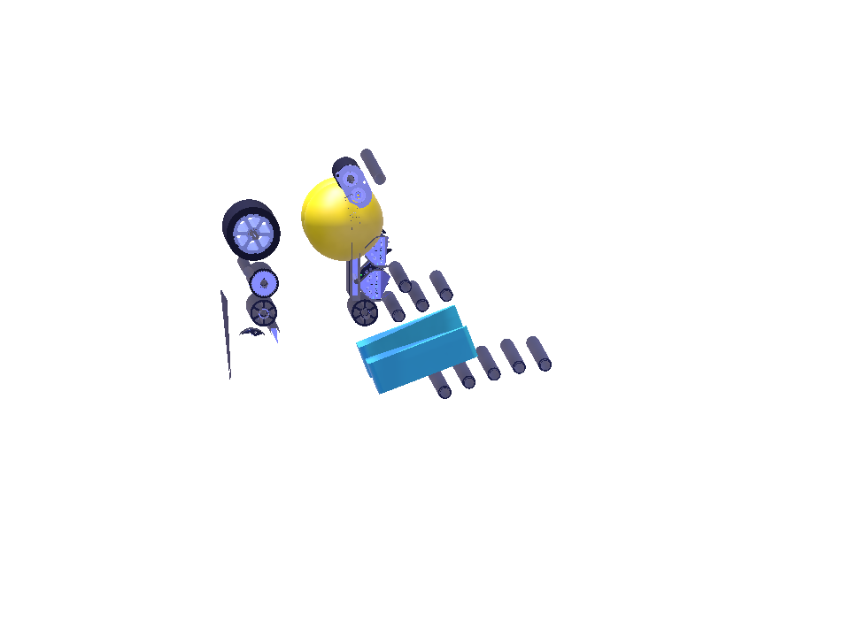
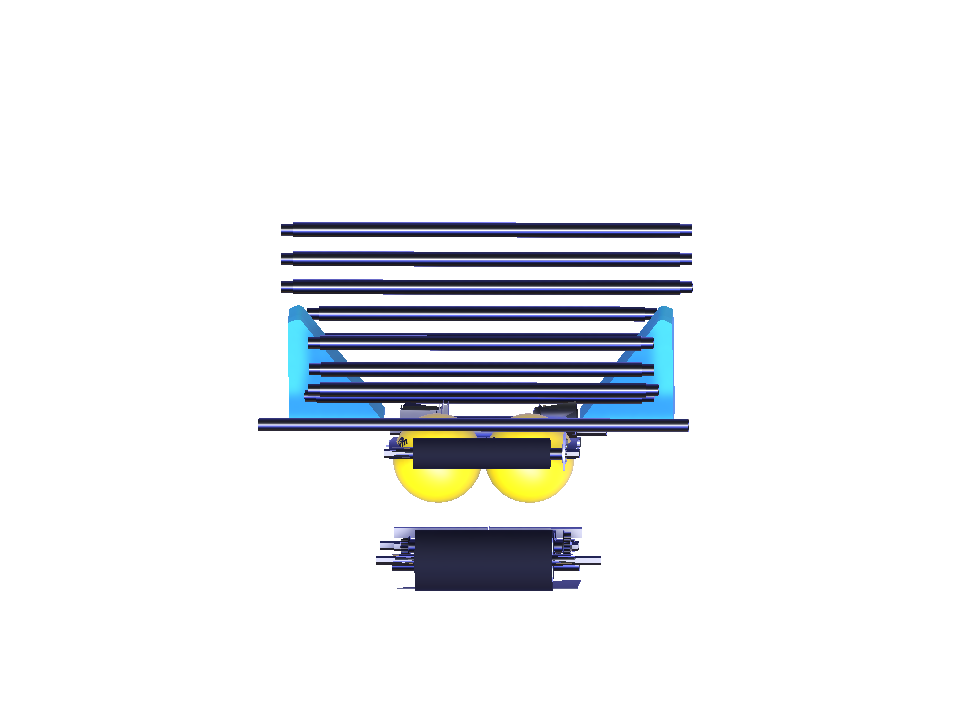
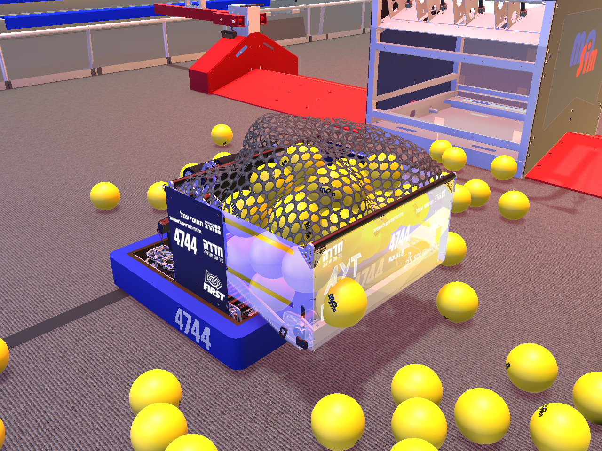

# Turbo 0.6.0 physics verification

The 0.6.0 editor and bundle fixtures below passed on 20 November 2026. Subsequent installed-player testing exposed missing solid bumper contacts and repeatable chassis stutter in dense fuel. These fixture results do not establish that full-hopper native cycles pass. The native correction and scoring investigation are still in progress.

The release fixtures use the Windows bundle and matching DLL from Unity 2023.2.22f1 / MoSim v26.6. Pickup integration uses the matching authoring prefab. Tests run at simulation speed 1, with a 4.5 ms physics step, using the normal keyboard action bindings and independent stock MoSim fuel bodies. The pinned team-code commit is `2bd34881f2c39f86a74cc7d3ea18ba6e00678493`.

| Check | Measured result |
| --- | --- |
| Two-floor indexer | Eleven fixtures, 20/20 native hub scores, with a lower-entry witness for every ball. |
| Lower-floor pair | Two concurrent shooter contacts; muzzle crossings 0.36 ms apart. |
| Upper-floor pair | Two upper-floor contacts, downward transfer, two concurrent shooter contacts; muzzle crossings 13.89 ms apart. |
| Passive triangles | Both shoulders and both outer corners record real upward collision contact before feed; asymmetric guide load scores 3/3. |
| Singles and mixed floors | Center, left and right singles score without a pairing wait; mixed four-ball load scores 4/4. |
| Blocked drop and shooter | Both recover and score after obstruction removal; measured reverse-command duration about 0.508 s. |
| Pickup integration | Same-ball pickup, feed and release; reverse load support, disable, preload retention and stow pass. |
| Stationary shooting | 40/40 scores across 2.25, 3, 4, 4.5 and 5 m. |
| Alliance matrix | 64/64 scores across both alliances, both firing sides, 2.5 and 4 m. |
| Moving shooting | 16/16 scores; three hard pump cycles per case; measured pump stroke 0.174–0.240 m. |
| Delivery | 32/32 first landings within the existing 1.25 m target tolerance. |
| Retention | 9/9 collected and retained at each heading, no escapes, loaded stow succeeds. |
| Approach | 9/9 collected and retained in all six cases at 0.5, 2 and 4 m/s; maximum tilt under 0.73 degrees. |
| Rail impact | Physical limits, disable and stow pass at 0, 90, 180 and -90 degrees with the existing 40 N·s actuator impulse. Maximum measured intake extension 0.240054 m. |
| Thirty-ball load | 30/30 collected, retained through driving, and released at both headings; no escapes. |
| Larger fill | 53 and 52 stored, retained through driving, and fully released; no escapes. Loaded native speeds exceed 3.9 m/s. |
| Dense wheel-path pile | 37 and 40 collected, retained and fully released, no escapes; 3.36 and 3.46 m travel; 0.56 and 1.24 degrees approach drift; maximum cross-track error 0.027 m. |
| Quick input pulses | 8/8 scores and three hard pump cycles from latched, same-frame input taps. |

Both dedicated pair fixtures remain below the original 50 ms limit. The indexer shares a 320 N traction budget across the two powered floors. The triangular assemblies have no powered contact or driven animation. Runtime fuel transport uses no parenting, freezing, repositioning, direct velocity assignment or correction after release.

The intake side-guide proxies previously intercepted corner fuel ahead of the CAD triangles. Their rear ends now stop at the first lower roller, preserving their forward pickup extent. The guide fixtures log the actual contacting collider and contact normal, including first impacts when fuel immediately rolls onto the lower bed.

The collection counters include the new lower roller bed and accelerator holding volume; ground fuel remains outside the counted regions. Delivery observes the first carpet impact as well as the sampled descent, preventing a missed editor frame from counting a later bounce as the first landing. Test inputs are restricted to the fixture keyboard so watching or typing cannot drive the robot.

The wheel-path driver keeps its existing 3 m/s command and 3.4 m distance target, using the former settling period to finish the sweep when dense fuel slows the drivetrain. The initial eight-second cutoff stopped one approach at 3.015 m. Its failed report is preserved in [wheel-pile-initial-short-sweep.json](../Reports/Archive-0.6.0/wheel-pile-initial-short-sweep.json). The minimum 3.1 m travel, maximum 3 degree approach heading drift, 0.20 m cross-track error, retention, release and stability criteria are unchanged. The approach observer retains every sample from the original eight-second window and adds any remaining sweep and braking. Additional stationary settling after that window and completed sweep is recorded separately.

A completed-sweep attempt reached 3.14 degrees and failed the heading criterion; that report is preserved in [wheel-pile-initial-drift-3deg.json](../Reports/Archive-0.6.0/wheel-pile-initial-drift-3deg.json). [Further diagnostics](../Reports/Archive-0.6.0/wheel-pile-settling-drift.json) located a 3.10 degree peak at 9.83 s, with the robot nearly stationary at 0.023 m/s. The source disables automatic heading lock, so zero turn-rate input does not establish an absolute idle heading. The final approach run passes the unchanged limits. Its separately recorded extra settling peaks are 0.00 and 0.44 degrees. Dense-pile contact and packing can change between runs; the preserved reports show that variation.

Contact speeds, force budgets, roller-core compliance and actuator ramps remain explicit simulator calibration, rather than measured hardware transmission or torque. See [Mechanisms](Mechanisms.md), [Robot-code mapping](RobotCodePort.md), and the [calibration record](../Reports/Archive-0.6.0/indexer-calibration.json). These fixtures establish the measured simulator behavior, not every possible pile, field collision or real-robot shot.

Bundle SHA-256: `5895b0bd04b9a6a8fcc958295b84cedbf53749969046065426c87cab9f365bf6`

DLL SHA-256: `9523da3ef4fdd2071feaf0f43a797e69aa1b5c4edbfabdd15f81fd3fcd723395`

Earlier results remain in [Verification 0.5.6](Verification-0.5.6.md). The detailed final fixtures and samples are in the JSON reports under `Reports/`.

