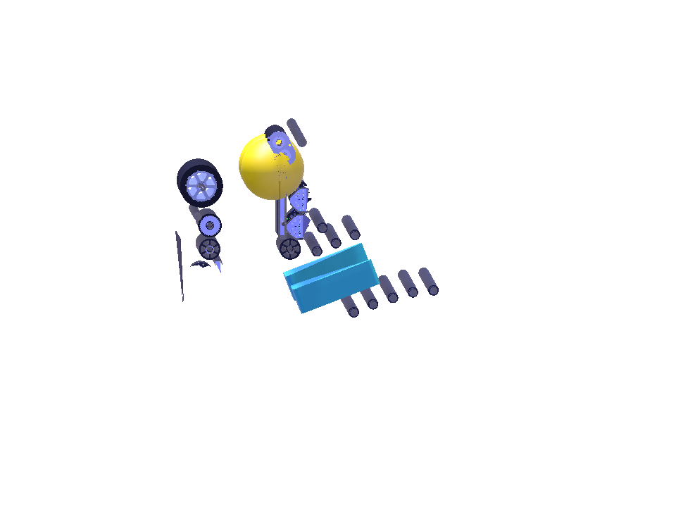
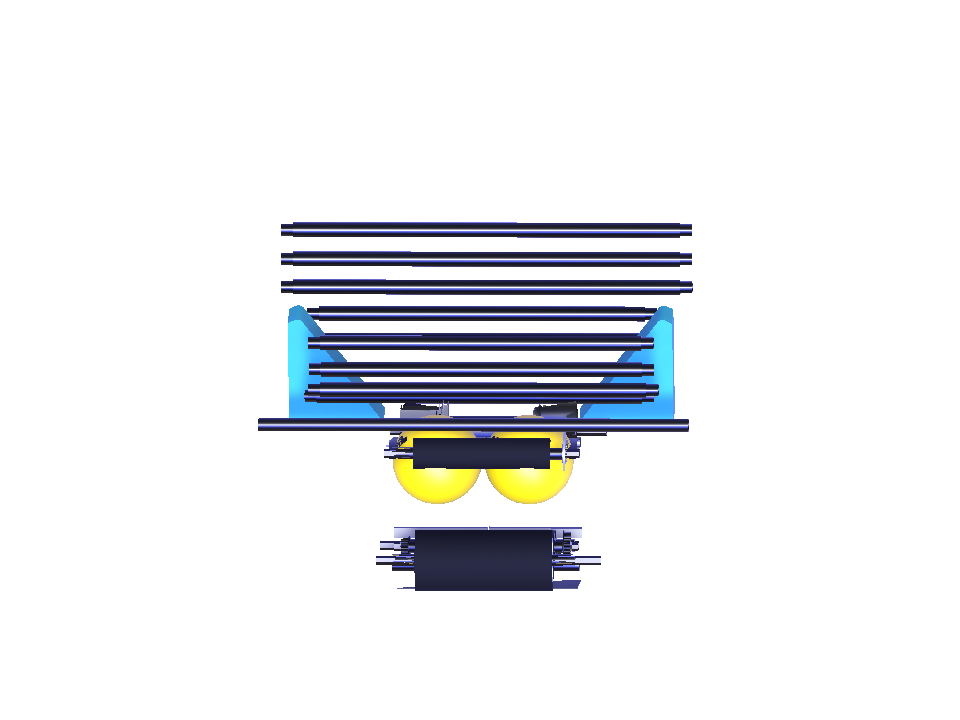

# Turbo 0.6.2 verification

All fourteen complete fixture groups pass against the fingerprints below. Tests run in visible Game views using the built Windows bundle and normal action bindings. Shooting and indexer fixtures run at simulation speed 1 and the native 4.5 ms physics step. Existing pickup, capacity, retention, drift, scoring and pair-timing thresholds remain unchanged.

| Check | Measured result |
| --- | --- |
| [Integration](../Reports/Release-0.6.2/physics-diagnostics.json) | Pickup, same-ball feed/release, preloads, reverse support, disable and staged stow pass. |
| [Travel](../Reports/Release-0.6.2/travel-after.json) | Four headings; actuator impulse, disable and end stops pass. |
| [Retention](../Reports/Release-0.6.2/retention-after.json) | 18 collected and 18 retained; zero escapes; loaded stow passes. |
| [Approach](../Reports/Release-0.6.2/approach-after.json) | 54 collected and 54 retained; zero escapes; loaded stow passes. |
| [Systems](../Reports/Release-0.6.2/systems-after.json) | 7 cases; 40/40 scores; required pumping and movement checks pass. |
| [Jam](../Reports/Release-0.6.2/systems-jam.json) | 3 recoveries; 0.492 s reverse; obstruction contact and resumed release pass. |
| [Indexer](../Reports/Release-0.6.2/systems-indexer-after.json) | Eleven cases; 20/20 scores; pair exits 0.00 ms/0.00 ms, interpolated from 4.5 ms steps and both below 50 ms; passive guides, corners, singles and blocked paths pass. |
| [Moving](../Reports/Release-0.6.2/systems-moving-after.json) | 2 cases; 16/16 scores; required pumping and movement checks pass. |
| [Delivery](../Reports/Release-0.6.2/systems-delivery-after.json) | 32/32 first landings within the unchanged 1.25 m tolerance. |
| [Matrix](../Reports/Release-0.6.2/systems-matrix-after.json) | 8 cases; 64/64 scores; required pumping and movement checks pass. |
| [Capacity](../Reports/Release-0.6.2/capacity-after.json) | 0°: 30/30/30; 90°: 30/30/30 collected/retained/released; zero escapes. |
| [Pile](../Reports/Release-0.6.2/pile-after.json) | 0°: 53/53/53; 90°: 52/52/52 collected/retained/released; zero escapes. |
| [WheelPile](../Reports/Release-0.6.2/wheel-pile-after.json) | 0°: 46/46/46; 90°: 44/44/44 collected/retained/released; zero escapes. Drift 0.71°/0.66°. |
| [Pulse](../Reports/Release-0.6.2/systems-pulse-after.json) | 1 case; 8/8 scores; required pumping and movement checks pass. |

Capacity, Pile and WheelPile schedule their existing 0.5 s forward / 1 s reverse keyboard pulses on physics steps. Velocity samples include the result of the final commanded step: Unity advances physics after `FixedUpdate` ([execution order](https://docs.unity3d.com/2023.2/Documentation/Manual/ExecutionOrder.html)). The 3.5 m/s loaded-speed minimum is unchanged. The [frame-driven failure](../Reports/pile-062-loaded-speed-failure.json), [short-pulse physics measurement](../Reports/pile-062-physics-sampled-short-input.json), [pre-step endpoint comparison](../Reports/pile-062-physics-pulses-prestep.json) and [isolated corrected-clock check](../Reports/pile-062-physics-pulses-endpoint.json) remain preserved separately from the complete release groups above.

The installed-player trench cycles use the original 504 field fuel bodies. Actual stowed loads are counted before driving, and every member must remain through the crossing. Acceptance requires zero spills, full retraction, no sustained stop, matched installed artifact hashes and no diagnostic overrides. At least one cycle carries exactly 60 balls; both alliances and slow/normal gears are covered.

| Installed-player cycle | Alliance | Stowed / retained | Minimum trench speed (m/s) | Stored spills / inlet departures | Scored / remaining |
| --- | --- | --- | --- | --- | --- |
| [062-grip140-blue-full](../Reports/native/062-grip140-blue-full.json) | Blue | 57 → 57 | 1.50 | 0 / 0 | 57 / 0 |
| [062-grip140-blue-repeat](../Reports/native/062-grip140-blue-repeat.json) | Blue | 58 → 58 | 1.53 | 0 / 0 | 55 / 0 |
| [062-grip140-blue-target62](../Reports/native/062-grip140-blue-target62.json) | Blue | 60 → 60 | 1.52 | 0 / 5 | 58 / 0 |
| [062-grip140-red-normal](../Reports/native/062-grip140-red-normal.json) | Red | 56 → 56 | 3.15 | 0 / 0 | 54 / 0 |

The additional [native bump/delivery cycle](../Reports/native/062-grip140-blue-bump-delivery.json) carried 56 balls over the bump beside the hub and retained all 56, with zero stored spills. It released 56, delivered 56 within 1.25 m of the target, and ended empty. Peak tilt was 15.04°. The front carrier briefly deflected 31.9 mm during the impact, within the existing Travel fixture's 35 mm impact/stow envelope. Trench acceptance retains its stricter 15 mm rail-clearance limit. The [bump certificate](../Reports/native-bump-0.6.2.json) checks the raised route, retained bodies, normal input commands and matching artifacts.

Across these 4 trench cycles, recorded collection, return and shooting frames peaked at 16.64 ms. The checker rejects recorded phase frames at or above 250 ms and sustained pose/velocity holds under the trench.

Inlet departures count arrivals that never completed storage; they are recorded separately from losses of stored fuel. Pre-stow stored fuel must also survive retraction. Scoring counts are actual game events; remaining means fuel still in the robot at the end. The native traces record the full collection, stow, transit and shooting cycle separately from the fixture suite. [Native procedures and evidence](NativeTesting.md) explain the measurements.

The powered floors and wide shooter retain shared force budgets and chassis reaction. Side triangles remain passive. The main hopper and roof frame stay fixed; only the intake/kicker retracts. Fuel stays independent, with original geometry and mass, no parenting, repositioning, freezing or assigned velocity. Contact compliance and textile/traction parameters are explicit simulator calibration; see [mechanisms](Mechanisms.md) and [calibration](../Reports/indexer-calibration.json).

The cutaway hides panels and cloth rendering for inspection; their physics remain active.

Bundle SHA-256: `816835e241cc5d7b28f6cdbc3ef9881d1014da0f07e3374e46e7ff50f0ac4476`

DLL SHA-256: `ebe4ba9ad58e9c680cb49387efecbf7cbc5d304a14089deb6eba6d406b231140`

The [certificate](../Reports/Release-0.6.2/verification-0.6.2.json) records every group and matching hash. Earlier results and fixture corrections remain in [0.6.1 verification](Verification-0.6.1.md).
