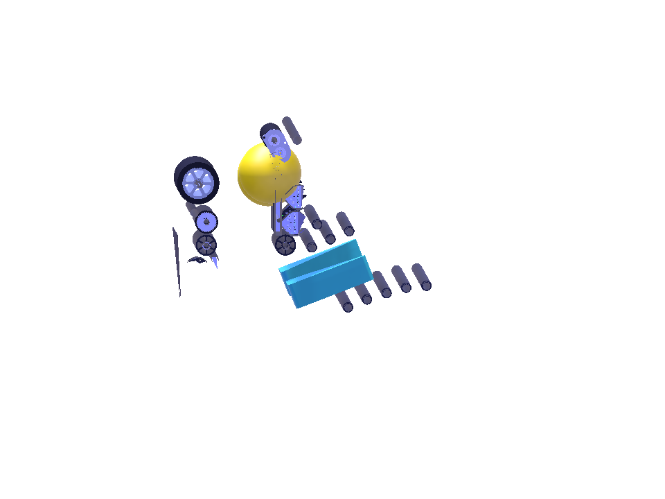
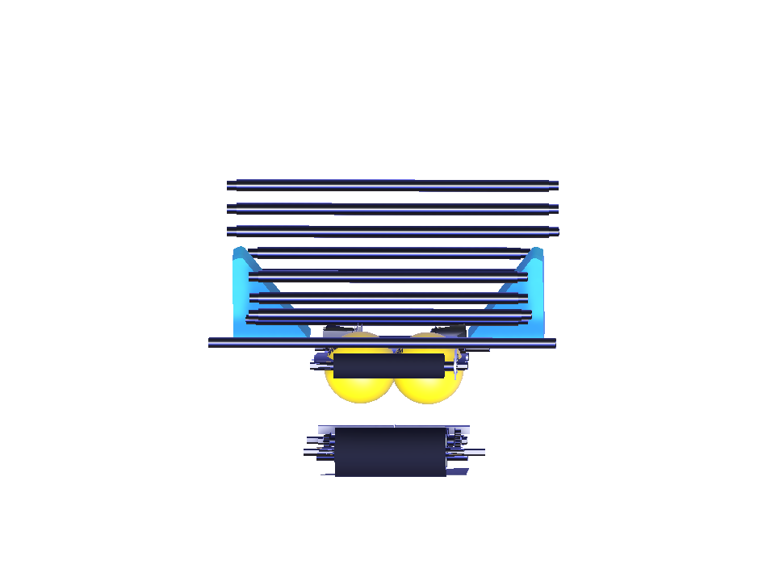
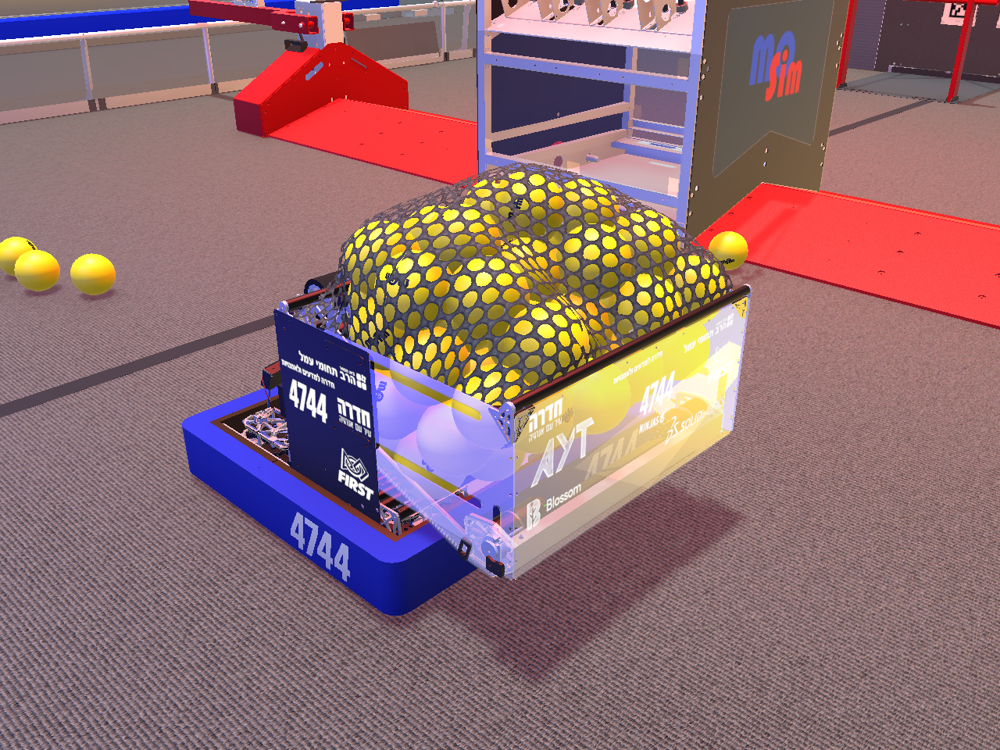

# Turbo 0.6.1 verification

The corrected assembly keeps the main hopper walls, floor and net frame fixed;
only the intake/kicker retracts. Solid CAD bumper contacts, discrete chassis
collision detection, native-safe roller definitions and hard-pump priority are
included in this build. The original net slack and finite drive calibration are
preserved. A tighter-net comparison failed capacity and was rejected.

The package-required fixture suite passes against the fingerprints below. Tests
use the normal action bindings, stock independent MoSim fuel, and visible Game
views. Shooting and indexer fixtures run at simulation speed 1 with the native
4.5 ms physics step. Collection, retention, scoring, pair timing, drift and
capacity acceptance thresholds remain unchanged. The fixed net's closed frame
span expectation now follows the team's confirmed stationary hopper geometry.
Loaded-stow observation now includes the fixed bin's front section: the measured
front panel permits a ball centre near local Z 0.552 m. The old contracted-bin
cutoff excluded supported fuel at Z 0.427–0.442 m; that failed report is preserved.

| Check | Measured result |
| --- | --- |
| [Pickup integration](../Reports/physics-diagnostics.json) | Same-ball pickup, feed and release; preload retention, reverse support, disable, staged kicker and stow pass. |
| [Rail limits](../Reports/travel-after.json) | Four headings pass the existing actuator-impulse, disable and stow checks; maximum intake extension 0.242274 m. |
| [Retention](../Reports/retention-after.json) | 2 cases; 18/18 collected, 18 retained; zero escapes; loaded stow passes. |
| [Approach](../Reports/approach-after.json) | 6 cases; 54/54 collected, 54 retained; zero escapes; loaded stow passes. |
| [Two-floor indexer](../Reports/systems-indexer-after.json) | Eleven fixtures; 20/20 scores. Lower/upper pair muzzle separation 4.80/11.12 ms; both remain below 50 ms. Passive shoulders, corners, asymmetric loads, singles, mixed floors and blocked paths pass. |
| [Systems](../Reports/systems-after.json) | 7 cases; 40/40 scores; required hard-pump cycles and motion checks pass. |
| [Moving shots](../Reports/systems-moving-after.json) | 2 cases; 15/16 scores; required hard-pump cycles and motion checks pass. |
| [Alliance matrix](../Reports/systems-matrix-after.json) | 8 cases; 64/64 scores; required hard-pump cycles and motion checks pass. |
| [Input pulses](../Reports/systems-pulse-after.json) | 1 case; 8/8 scores; required hard-pump cycles and motion checks pass. |
| [Jam recovery](../Reports/systems-jam.json) | 3 recoveries; 0.508 s measured reverse command; 5 obstruction contacts; no early release; 3 hard cycles after recovery; 1 score. |
| [Delivery](../Reports/systems-delivery-after.json) | 31/32 first landings within the existing 1.25 m tolerance. |
| [Capacity](../Reports/capacity-after.json) | 0°: 30/30/30; 90°: 30/30/30 collected/retained/released; zero escapes; empty stow passes. |
| [Larger fill](../Reports/pile-after.json) | 0°: 53/53/53; 90°: 53/53/53 collected/retained/released; zero escapes; empty stow passes. |
| [Wheel-path pile](../Reports/wheel-pile-after.json) | 0°: 59/59/59; 90°: 60/60/60 collected/retained/released; zero escapes; empty stow passes. |

The dedicated indexer and shooter share finite force budgets with equal chassis
reaction. The triangular guides have no powered traction or driven animation.
Lower-mouth contact uses the ball's lower surface crossing the configured mouth
top; an upper-floor ball must descend before the contact can engage.
Fuel remains independent throughout, with no runtime parenting, repositioning,
freezing, direct velocity assignments or corrections after release.

Installed-player full-hopper cycles are separate from these fixtures. The native
dense-fuel stop-and-jump failure was reproduced and corrected; the bin-motion
correction allows full-load stow. Trench retention remains a recorded limitation,
and no blanket native-cycle pass is claimed. See [installed MoSim testing](NativeTesting.md)
and the [native traces](../Reports/native-dense-contact-audit.json) for actual
counts, speeds, failures, requests and artifact fingerprints.

The jam fixture now introduces its ball after removed preloads are inactive and
the robot has settled. It requires real obstruction contact and no launch before
removal. Seeded indexer fixtures start with a clear initial cloth pose, avoiding
the former insertion into a sagged net. Pair and mixed-floor arrivals are seeded
with feeding ready; passive guides retain their idle support check. The capacity
observer runs on physics steps. The exact Unity Package
Manager authentication failure is recorded separately in `editorServiceErrors`;
all other runtime error handling and acceptance remain active. Failed reports
are preserved alongside the final reports.

The preserved capacity failure exposed a field-boundary impact during loaded
braking: Side2 produced a 220.323 N·s impulse at 10.648 s. The zero-degree start
now leaves more room for the same collection, drive and braking sequence;
the other heading and all existing thresholds remain unchanged. This fixture
additionally requires zero obstacle contacts during the measured drive segment.
The initial failure and collision trace are preserved.

The former 5 m firing corner also spawned into the alliance boundary. Its
original-position control recorded 288 field contacts, including initial
penetration impulses above 7000 N·s. The firing bearing now provides clearance
at the same 5 m radius, with every field collider retained. Five stock-geometry
repeats scored 40/40 with zero setup contacts; the release fixture additionally
requires that clearance and the actual spawn radius. Hood/rim geometry
comparisons remain preserved diagnostics; the packaged geometry is retained.

Moving-shot diagnostics preserve the initial 8/8 and 6/8 scoring result,
the traced 16/16 repeat, and the isolated rear-rim and direct-brake comparisons.
Removing the rim still missed two shots. Directly targeting the existing
accelerator brake during re-aiming removed the motor-reference delay; its
comparison scored 16/16. The table above records the final runtime's required
checks separately from those diagnostic runs.

The cutaway hides the outer panels and cloth rendering for inspection; their
physics remain active during the fixtures.

Bundle SHA-256: `525f113be5c3fd0ba069b5db2914a7c2431789eae67b5c4ea9abd94b32697968`

DLL SHA-256: `f23e0b5e971a78f52771e9afa1877b6be287b7d0fcac7d68e05c4a23ded2d1de`

Earlier fixture results remain in [Verification 0.6.0](Verification-0.6.0.md). Contact geometry, speeds, compliance and force budgets are simulator calibration; see [Mechanisms](Mechanisms.md) and the [calibration record](../Reports/indexer-calibration.json).
