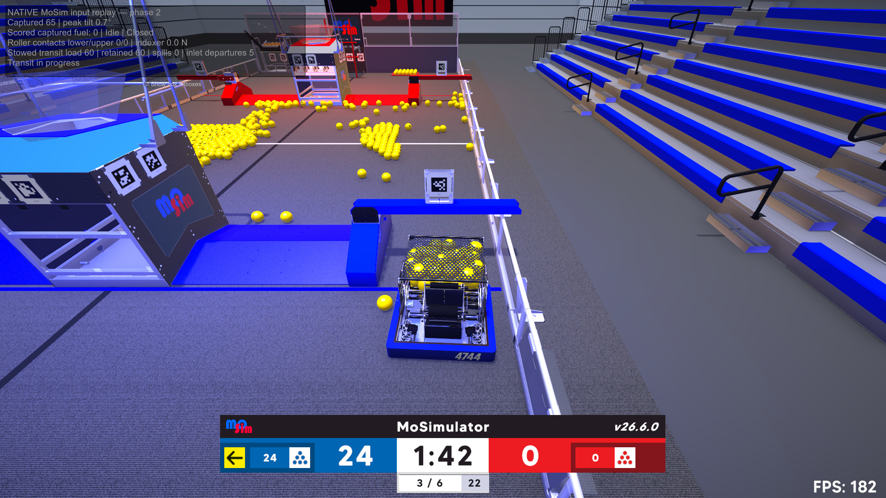

# MoSim2026 — Ninjas 4744 Turbo

An editable MoSim / Rebuilt robot mod built from the team's approved 2026 Turbo CAD asset. This repository contains the robot assets, runtime code, authoring tools, and regression checks. Unity, the MoSim framework, and generated caches stay outside the repository.



## Install

Extract the Windows release ZIP into:

```text
%USERPROFILE%\AppData\LocalLow\CascadeStudios\MoSim\Mods\
```

The resulting `Ninjas4744-Turbo2026/standalonewindows64` folder must contain `modpack.json`, `Ninjas4744.dll`, and the asset bundle. Restart MoSim, enable **Ninjas 4744 Turbo 2026** in Mods, select Rebuilt, and choose **4744 / Turbo**. Keep one Turbo version enabled. Disable older copies by renaming their modpack.json to modpack.json.disabled. Restart after updating: Unity cannot unload the old mod assembly during a game session.

## Controls

| Action | Keyboard | Gamepad |
| --- | --- | --- |
| Cancel shooting, open intake and collect | Shift | Left trigger |
| Aim/shoot at the hub or a side delivery target by field zone; press again for three hard pump cycles | K | Right trigger |
| Start delivery; press again for three hard pump cycles | E | Right bumper |
| Shoot at the fixed manual setting | Q | Left bumper |
| Stow intake/hopper | Z | D-pad down |
| Run three hard pump cycles, then soft pumping | V | Y / Triangle |
| Reverse the feed path | U | A / Cross |

Pumping slides the hopper bin and its front roof frame back and forth toward the stationary indexer. Z / D-pad down retracts the intake and hopper. The tray overlaps the fixed indexer entrance as the bin moves.

MoSim's control rebinding applies normally. The shooter faces the rear of the robot. Commands latch, matching the team's button-triggered state machine: release K/E after starting, and use Shift to cancel. Intake opens automatically after enable. Soft pumping starts with hub shooting or delivery while balls remain in storage, including a partial load, and stops when storage clears or shooting is cancelled. Hub aiming reduces translation to 30%, as in the team code; Shift restores normal driving. F8 toggles an optional local mechanism/status panel. Quick shoot, pump and stow taps are retained through Input System performed events. Q and U remain held manual overrides. These are MoSim action bindings, rather than the real driver's PS5 button layout.

## Build and test

### Code formatting

[CSharpier](https://csharpier.com/docs/Installation) is pinned in `.config/dotnet-tools.json`.
Install the [.NET 10 SDK](https://dotnet.microsoft.com/download/dotnet/10.0), then run:

```powershell
.\Tools\Format.ps1        # Restore CSharpier and format the code
.\Tools\Format.ps1 -Check # Check formatting without changing files
```

The helper also supports a local SDK in `.dotnet/`. With an SDK on your
PATH, the equivalent commands are `dotnet tool restore`, `dotnet csharpier format .`,
and `dotnet csharpier check .`. `.editorconfig` sets four-space indentation,
100-column wrapping, and LF line endings. Generated files and tool caches are excluded
through `.gitignore`; upstream source records and licenses through `.csharpierignore`.
Editor format-on-save support is available through the CSharpier plugin for Rider,
Visual Studio, or VS Code.

### Unity build and regression checks

Use **Unity 2023.2.22f1** and the [official MoSim modding project](https://github.com/MoSimulator/MoSimulator-Public) at commit `d7e2f2bb2af1eb8c46cd5ff3697f25392d6004d1` (v26.6). An activated Unity editor and Windows build support are required.

```powershell
$project = 'C:\path\to\MoSimulator-Public'
$unity = 'C:\path\to\Unity\Editor\Unity.exe'
.\Tools\Invoke-Unity.ps1 -MoSimProject $project -UnityEditor $unity -Task Assemble
.\Tools\Invoke-Unity.ps1 -MoSimProject $project -UnityEditor $unity -Task Build
.\Tools\Test-Visible.ps1 -MoSimProject $project -UnityEditor $unity # all 14 required groups
.\Tools\Invoke-Unity.ps1 -MoSimProject $project -UnityEditor $unity -Task Test -Visible
.\Tools\Invoke-Unity.ps1 -MoSimProject $project -UnityEditor $unity -Task Travel -Visible
.\Tools\Invoke-Unity.ps1 -MoSimProject $project -UnityEditor $unity -Task Swerve
.\Tools\Invoke-Unity.ps1 -MoSimProject $project -UnityEditor $unity -Task Trench
.\Tools\Invoke-Unity.ps1 -MoSimProject $project -UnityEditor $unity -Task Trench -DiagnosticArguments '-turboPinch'
.\Tools\Invoke-Unity.ps1 -MoSimProject $project -UnityEditor $unity -Task Retention -Visible
.\Tools\Invoke-Unity.ps1 -MoSimProject $project -UnityEditor $unity -Task Approach -Visible
.\Tools\Invoke-Unity.ps1 -MoSimProject $project -UnityEditor $unity -Task Indexer -Visible
.\Tools\Invoke-Unity.ps1 -MoSimProject $project -UnityEditor $unity -Task Systems -Visible
.\Tools\Invoke-Unity.ps1 -MoSimProject $project -UnityEditor $unity -Task Jam -Visible
.\Tools\Invoke-Unity.ps1 -MoSimProject $project -UnityEditor $unity -Task Moving -Visible
.\Tools\Invoke-Unity.ps1 -MoSimProject $project -UnityEditor $unity -Task Delivery -Visible
.\Tools\Invoke-Unity.ps1 -MoSimProject $project -UnityEditor $unity -Task Matrix -Visible
.\Tools\Invoke-Unity.ps1 -MoSimProject $project -UnityEditor $unity -Task Capacity -Visible
.\Tools\Invoke-Unity.ps1 -MoSimProject $project -UnityEditor $unity -Task Pile -Visible
.\Tools\Invoke-Unity.ps1 -MoSimProject $project -UnityEditor $unity -Task WheelPile -Visible
.\Tools\Invoke-Unity.ps1 -MoSimProject $project -UnityEditor $unity -Task Pulse -Visible
.\Tools\Package.ps1 -MoSimProject $project
```

The verified sliding-hopper test build can be archived with
`python Tools/package_verified_build.py`. It checks the six mod-file hashes, runtime
source fingerprints, native shooting result and twelve packaged trench/pinch cases,
then verifies every ZIP entry. The filename includes `0.6.2-sliding-hopper-r3`; build
notes describe its targeted validation and the remaining full-load stow check.
`Tools/Package.ps1` continues to require the complete release certification.

For the swerve hitbox build, use
`python Tools/package_verified_build.py --profile swerve --verification Reports/swerve-modules-r4/verification.json --label swerve-modules-r4`.
This validates all forty collision probes, normal driving, three-ball shooting and
eight empty-floor trench geometry cases against the archived build fingerprints.

The test examples use `-Visible` to show Unity's Game view. Indexer tests show a live cutaway with the fixture name and contact counts; other checks follow the robot and shooting target.

`Trench` checks reverse escape at angled poses in all four field trenches, with the intake stowed and deployed. `-turboPinch` isolates opposite bumper corners with 1 mm overlap on each side. `-turboRigidPinch` pinches the hopper/frame above the bumpers with empty and loaded hoppers. Pass either flag through `-DiagnosticArguments`. Both fixtures require wheel traction to return and check that driving into a side still stops at the solid wall. `-Baseline` disables the contact handler for comparison; the controlled pinches are expected to fail. These checks use the authoring prefab in the Unity editor and are separate from installed-player release certification. [Trench contact results](Reports/trench-verification.json).

The commands copy only this mod's assets and editor tools into the selected project. Assemble regenerates the prefab; commit manual prefab edits before using it. Build preserves the current prefab, runs a fresh-session SDK runtime synchronization, and produces the official MoSim asset bundle, DLL, manifest, and Unity package. Test checks the complete pickup-to-shot path and disabled shutdown. Travel checks physical rail limits at four headings, including an actuator impulse. Retention follows collected field fuel through maneuvering, disable, and stow. Systems measures empty/loaded driving, cloth deployment, hard pumping, and actual hub scores at five distances. Packaging verifies the reports against the exact bundle and DLL. Generated outputs go to `Artifacts/` and `dist/`.

## What changed in 0.6.2

- Added field-box contacts for the roof net and calibrated its cord size and tension.
- Added bounded fuel-to-fuel compliance inside the fixed hopper, preserving stock fuel geometry and mass.
- Separated powered intake traction from passive support and completed the moving inlet handoff during stow.
- Increased slide velocity damping while preserving the 350 N force limit.
- Calibrated full-load tread grip to 1.4 while preserving the team drive constants.
- Verified native stowed trench crossings with actual loads of 57, 58, 60, 56 balls, retaining every member through the crossing. Both alliances, slow and normal returns, and an actual 60-ball load are covered.

All fourteen required fixture groups pass against this release's bundle and DLL. [Measured results](Docs/Verification.md) · [Native requests, traces and screenshots](Docs/NativeTesting.md). Incomplete arrivals at the inlet are reported separately; pre-stow stored fuel must survive retraction as well as transit. Earlier failed runs remain preserved.

## What changed in 0.6.1

- Added the missing solid bumper perimeter while keeping the framework's bounds trigger hollow.
- Corrected the reproduced stop-and-jump chassis motion in dense fuel with discrete contacts at the native 4.5 ms physics step.
- Replaced the indexer's nested serialized roller array after native loading left it empty; both floors now apply traction in the installed player.
- Kept explicit hard-pump requests active through jam recovery instead of allowing the delayed soft-pump default to interrupt them.
- Applied the finite accelerator brake directly during re-aiming, without waiting for the motor reference to slow down.
- Fixed the main hopper to the chassis; only the intake/kicker retracts.
- Added opt-in visible native input replays, live hitbox outlines and saved cycle evidence. [Native testing and current limitations](Docs/NativeTesting.md).

The earlier 0.6.1 native full-load stow run used a fixed main hopper. Those results do not certify packed-load stow for the current sliding bin. The 0.6.1 stowed bump cycle peaked at 59 balls and scored all 57 present before shooting, with no transit escapes. A separate moving-shot-input cycle scored 53 total, with four measured moving muzzle crossings. Full-load trench traversal remained unresolved in 0.6.1. Full-hopper native outcomes are recorded separately from the Unity fixture suite.

## What changed in 0.6.0

- Two powered CAD roller floors feed the lower shooter entrance; the upper floor drops fuel down before shooting.
- Original triangular side supports passively guide shoulder fuel toward the lower mouth.
- The wide shooter accepts singles and two balls side by side, with shared force budgets and no pairing delay.
- `Indexer` checks each floor, side supports, asymmetric loads and physics-step pair release timing. [Calibration record](Reports/indexer-calibration.json) · [Pair top view](Reports/Turbo4744-v6-indexer-pair-top.png) · [Side cutaway](Reports/Turbo4744-v6-indexer-cutaway-side.png).

## What changed in 0.5.6

- Fuel no longer counts as a tread surface for the swerve modules, and wheel cores do not climb rigid balls.
- A narrow powered throat follows the upper kicker before handing balls into storage.
- Floor support stays closed after entry. An elastic net, frame-edge contacts and sloped rear shoulders retain a larger load.
- Two capacity runs each retained 53 balls through loaded driving and released all 53 through the shooter before empty stow.
- Jam detection measures ball travel so slow pumping does not repeatedly reverse progress.
- `Pile` verifies at least 50 stored balls at each heading and a load above 50 before loaded driving and complete unloading; `WheelPile` checks a faster approach across ball-filled wheel paths. [Verification](Docs/Verification.md).

The 0.5.6 dense-pile runs reached 2.46 degrees of heading drift, with 12 mm of sideways drift. The drivetrain commands turn rate rather than holding an absolute heading. Current approach and settling measurements, along with preserved initial failures, are in [Verification](Docs/Verification.md).

## What changed in 0.5.5

- The compact original CAD roller/bearing assembly replaces the inferred hanging supports. [Footage comparison](Reports/Turbo4744-kicker-reference-comparison.png).
- The lower kicker stays deployed during short hopper pump strokes. [Pumping preview](Reports/Turbo4744-kicker-pumping.gif).
- The structure stays rigid on the hopper. The hopper clears the bumper before only the lower kicker swings down.
- Closing raises the kicker first, then retracts the hopper. [Staged motion preview](Reports/Turbo4744-kicker-motion.gif).

## What changed in 0.5.4

- The lower kicker is attached to the moving hopper with visible support rails, hinge bearings, a front beam and bolted clear side plates.
- The kicker folds back with actual hopper travel and clears the bumper throughout deployment and retraction.
- [Motion preview](Reports/Turbo4744-kicker-motion.gif) · [Opened view](Reports/Turbo4744-kicker-open.png).

## What changed in 0.5.3

- Intake contact follows a curved pickup-to-tray path, with separate floor support and front-gate handoff. Reverse keeps the storage floor solid.
- Feed rollers use one force model per stage, with a slower indexer approach to the shooter. Fast and full-width approaches have a dedicated regression.

## What changed in 0.5.2
- The hopper roof uses MoSim's supplied net texture with larger, visible openings, rendering from both sides with depth and shadows.
- Unity previews verify the roof with the hopper [open](Reports/Turbo4744-net-open.png) and [closed](Reports/Turbo4744-net-closed.png).

## What changed in 0.5.1

- Standard shooting chooses HUB or DELIVERY from the team’s alliance-relative 3.6/5.6 m zone triggers.
- Side deliveries use the team’s two side targets and 58-to-55 RPS sweep with a separate floor-trajectory calibration.
- Moving aim uses measured MoSim flight timing and heading-rate feedforward; the indexer pauses during a large re-aim.
- Hopper transfer follows actual tray retraction. Intake force is shared across touching balls, and the cloth represents a 160 g textile.
- Added moving-shot, both-alliance, side-delivery, dense-pile loaded-drive and rendered-mesh pump checks.

## What changed in 0.4

- Replaced the scaled roof proxy with MoSim's deforming cloth net, attached to the fixed and sliding frame.
- Ported the team's prepare/ready/feed sequence, latched commands, three hard pump cycles, automatic soft pumping, shooting table, and five-iteration moving aim calculation from commit `2bd3488`.
- Coupled the physical hopper to the intake rail so pumping moves stored fuel toward the indexer.
- Corrected the drive motor unit conversion and applied the team's 0.75 joystick curve with a safe zero-input path.
- Revised the feed contacts and shooter hood, with a separately recorded MoSim wheel calibration.

See [the source-to-simulator mapping](Docs/RobotCodePort.md) for exact source values and hardware adapters.

## What changed in 0.3

- A continuous moving hopper floor supports stored fuel through the full rail travel.
- One-way intake contacts let incoming fuel enter while keeping stored fuel inside, including during disable and stow. Balls remain independent physics objects.
- Releasing intake keeps the transfer belt running inward at a reduced speed while extended or retracting.
- A new packaged-mod regression follows newly collected field fuel through storage and maneuvering, including real 90°/s turns.

## What changed in 0.2

- Physical travel stops constrain intake extension to 0.240 m and hopper extension to 0.22946 m.
- The slides use metre-based native joint control, bounded speed, acceleration, and actuator force. Their limits remain in effect while disabled.
- Preloads are actual MoSim fuel objects, with their original collision layers, detached through the normal game spawn handler.
- The intake roller's visible CAD mesh rotates with its simulated roller.
- The regression checks use the packaged bundle and real spawn flow. They check physical travel bounds rather than only checking whether a target was reached once.

The approved robot mesh remains intact as the starting point. The game copy is optimized to about 820,000 triangles. [Mechanism notes](Docs/Mechanisms.md) distinguish measured geometry from simulation calibration. This is a MoSim physics/controller port; it does not execute WPILib, CAN devices, vision, or autonomous paths. The model has no supported climbing mechanism.

[Release measurements](Docs/Verification.md) record collection, retained load, drive speeds, rail limits, pump cycles, and actual hub scores. [Team-code mapping](Docs/RobotCodePort.md) identifies the pinned source and physical adapters.

## Files

- `Assets/Prefabs/Games/Rebuilt/Robots/Mods/Ninjas4744/`: runtime script, prefabs, metadata, model export, materials, textures, and tutorial cards.
- `Assets/Editor/`: prefab builder and integration/regression checks.
- `Models/robot.blend`: packed, editable Blender game model; kept outside Unity's Assets folder to avoid automatic Blender imports.
- `Tools/`: Windows build and packaging commands.
- `Docs/` and `Reports/`: source records, design notes, verification results, and representative previews.

This authoring repository excludes the Unity installation, the complete MoSim project, and creator-login files. Team marks and CAD retain their existing rights; see `Licenses/` and [source provenance](Docs/Provenance.json). No push or Workshop publication was performed as part of this build. Public release through MoSim's submission system is a separate step.
