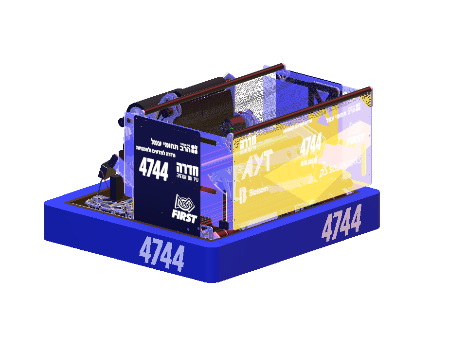

# MoSim2026 — Ninjas 4744 Turbo

An editable MoSim / Rebuilt robot mod built from the team's approved 2026 Turbo CAD asset. This repository contains the robot assets, runtime code, authoring tools, and regression checks. Unity, the MoSim framework, and generated caches stay outside the repository.



## Install

Extract the Windows release ZIP into:

```text
%USERPROFILE%\AppData\LocalLow\CascadeStudios\MoSim\Mods\
```

The resulting `Ninjas4744-Turbo2026/standalonewindows64` folder must contain `modpack.json`, `Ninjas4744.dll`, and the asset bundle. Restart MoSim, enable **Ninjas 4744 Turbo 2026** in Mods, select Rebuilt, and choose **4744 / Turbo**. Restart after updating: Unity cannot unload the old mod assembly during a game session.

## Controls

| Action | Keyboard | Gamepad |
| --- | --- | --- |
| Cancel shooting, open intake and collect | Shift | Left trigger |
| Start hub aiming and shooting; press again for three hard pump cycles | K | Right trigger |
| Start delivery; press again for three hard pump cycles | E | Right bumper |
| Shoot at the fixed manual setting | Q | Left bumper |
| Stow intake and hopper | Z | D-pad down |
| Run three hard pump cycles, then soft pumping | V | Y / Triangle |
| Reverse the feed path | U | A / Cross |

MoSim's control rebinding applies normally. The shooter faces the rear of the robot. Commands latch, matching the team's button-triggered state machine: release K/E after starting, and use Shift to cancel. Intake opens automatically after enable. Soft pumping starts 0.8 seconds after feeding begins. Hub aiming reduces translation to 30%, as in the team code; Shift restores normal driving. Q and U remain held manual overrides. These are MoSim action bindings, rather than the real driver's PS5 button layout.

## Build and test

Use **Unity 2023.2.22f1** and the [official MoSim modding project](https://github.com/MoSimulator/MoSimulator-Public) at commit `d7e2f2bb2af1eb8c46cd5ff3697f25392d6004d1` (v26.6). An activated Unity editor and Windows build support are required.

```powershell
$project = 'C:\path\to\MoSimulator-Public'
$unity = 'C:\path\to\Unity\Editor\Unity.exe'
.\Tools\Invoke-Unity.ps1 -MoSimProject $project -UnityEditor $unity -Task Assemble
.\Tools\Invoke-Unity.ps1 -MoSimProject $project -UnityEditor $unity -Task Build
.\Tools\Invoke-Unity.ps1 -MoSimProject $project -UnityEditor $unity -Task Test
.\Tools\Invoke-Unity.ps1 -MoSimProject $project -UnityEditor $unity -Task Travel
.\Tools\Invoke-Unity.ps1 -MoSimProject $project -UnityEditor $unity -Task Retention
.\Tools\Invoke-Unity.ps1 -MoSimProject $project -UnityEditor $unity -Task Systems
.\Tools\Invoke-Unity.ps1 -MoSimProject $project -UnityEditor $unity -Task Jam
.\Tools\Package.ps1 -MoSimProject $project
```

The commands copy only this mod's assets and editor tools into the selected project. Assemble regenerates the prefab; commit manual prefab edits before using it. Build preserves the current prefab and produces the official MoSim asset bundle, DLL, manifest, and Unity package. Test checks the complete pickup-to-shot path and disabled shutdown. Travel checks physical rail limits at four headings, including an actuator impulse. Retention follows collected field fuel through maneuvering, disable, and stow. Systems measures empty/loaded driving, cloth deployment, hard pumping, and actual hub scores at five distances. Packaging verifies the reports against the exact bundle and DLL. Generated outputs go to `Artifacts/` and `dist/`.

## What changed in 0.4

- Replaced the scaled roof proxy with MoSim's deforming cloth net, attached to the fixed and sliding frame.
- Ported the team's prepare/ready/feed sequence, latched commands, three hard pump cycles, automatic soft pumping, shooting table, and five-iteration moving aim calculation from commit `2bd3488`.
- Coupled the physical hopper to the intake rail so pumping moves stored fuel toward the indexer.
- Corrected the drive motor unit conversion and applied the team's 0.75 joystick curve with a safe zero-input path.
- Revised the feed contacts and shooter hood, with a separately recorded MoSim wheel calibration.

See [the source-to-simulator mapping](Docs/RobotCodePort.md) for exact source values and hardware adapters.

## What changed in 0.3

- A continuous moving hopper floor supports stored fuel through the full rail travel.
- One-way intake contacts let incoming fuel enter while keeping stored fuel inside, including during disable and stow. Balls remain independent physics objects.
- Releasing intake keeps the transfer belt running inward at a reduced speed while extended or retracting.
- A new packaged-mod regression follows newly collected field fuel through storage and maneuvering, including real 90°/s turns.

## What changed in 0.2

- Physical travel stops constrain intake extension to 0.240 m and hopper extension to 0.22946 m.
- The slides use metre-based native joint control, bounded speed, acceleration, and actuator force. Their limits remain in effect while disabled.
- Preloads are actual MoSim fuel objects, with their original collision layers, detached through the normal game spawn handler.
- The intake roller's visible CAD mesh rotates with its simulated roller.
- The regression checks use the packaged bundle and real spawn flow. They check physical travel bounds rather than only checking whether a target was reached once.

The approved robot mesh remains intact as the starting point. The game copy is optimized to about 820,000 triangles. [Mechanism notes](Docs/Mechanisms.md) distinguish measured geometry from simulation calibration. This is a MoSim physics/controller port; it does not execute WPILib, CAN devices, vision, or autonomous paths. The model has no supported climbing mechanism.

[Release measurements](Docs/Verification.md) record collection, retained load, drive speeds, rail limits, pump cycles, and actual hub scores. [Team-code mapping](Docs/RobotCodePort.md) identifies the pinned source and physical adapters.

## Files

- `Assets/Prefabs/Games/Rebuilt/Robots/Mods/Ninjas4744/`: runtime script, prefabs, metadata, model export, materials, textures, and tutorial cards.
- `Assets/Editor/`: prefab builder and integration/regression checks.
- `Models/robot.blend`: packed, editable Blender game model; kept outside Unity's Assets folder to avoid automatic Blender imports.
- `Tools/`: Windows build and packaging commands.
- `Docs/` and `Reports/`: source records, design notes, verification results, and representative previews.

This authoring repository excludes the Unity installation, the complete MoSim project, and creator-login files. Team marks and CAD retain their existing rights; see `Licenses/` and [source provenance](Docs/Provenance.json). No push or Workshop publication was performed as part of this build. Public release through MoSim's submission system is a separate step.
